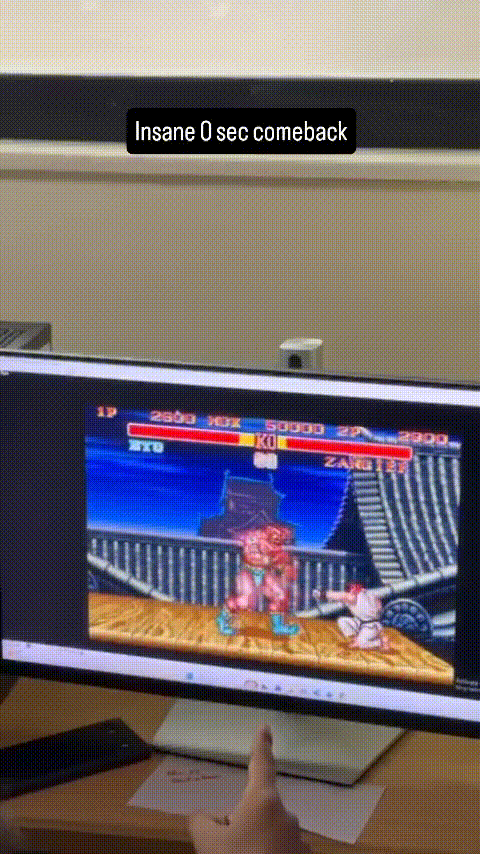
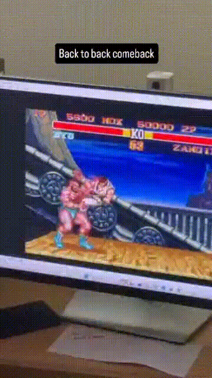
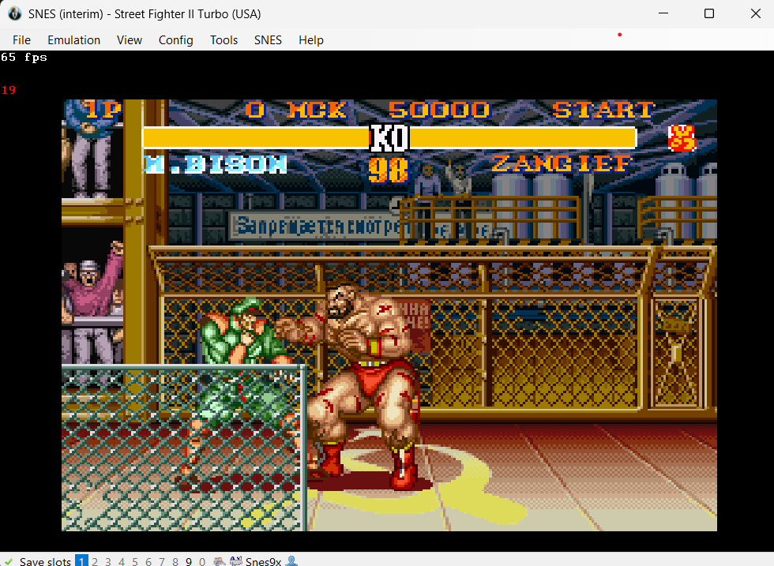
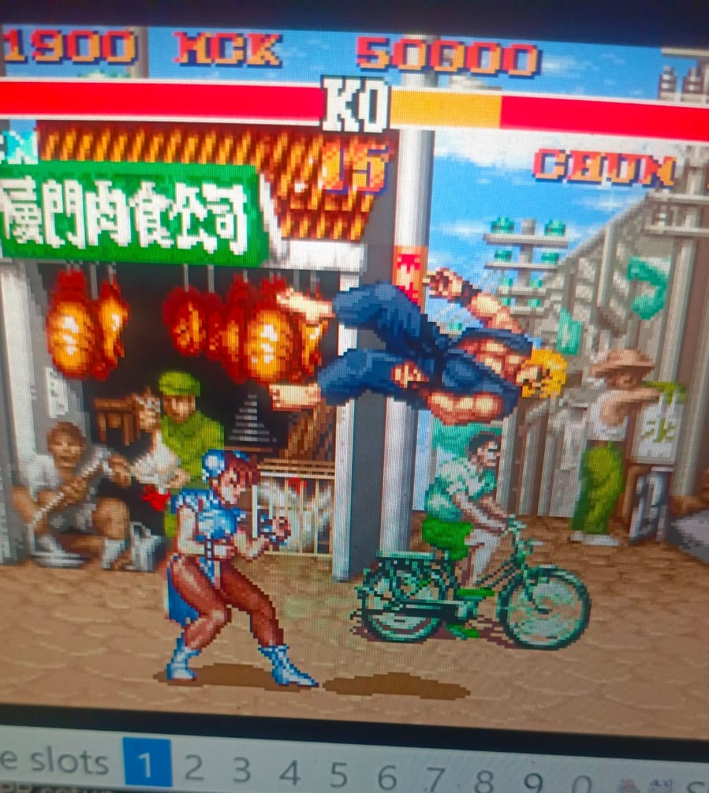

# SF2-Turbo-Bot-Training 🥋🤖
### Autonomous AI Agent for Street Fighter II Turbo (SNES) using Imitation Learning & TensorFlow

[](https://www.python.org/)
[](https://www.tensorflow.org/)
[](https://keras.io/)
[](https://en.wikipedia.org/wiki/Street_Fighter_II_Turbo)

**SF2-Turbo-Bot-Training** is a competitive AI agent built to play *Street Fighter II Turbo* on the Super Nintendo Entertainment System (SNES) via the BizHawk emulator socket protocol. The bot learns entirely from human gameplay demonstrations using deep imitation learning, predicting 60 FPS joystick movements and attack buttons with low latency (~2ms per frame) while strictly adhering to esports competition rules.

---

## ⚔️ Competition Highlights

#### Autonomous Bot in Action: Responsive Strike Timing & Spacing


*Live bot execution: The model observes real-time frame states from BizHawk, managing distance, anticipating opponent movement, and executing responsive attack decisions.*

<br>

#### Combo Strings & Anti-Spam Movement Flow


*Tournament playstyle: The bot maintains continuous offense and move variety, transitioning cleanly between high/low attacks while staying strictly within competition variety rules.*

---

## 🏋️ Training Highlights

#### Zangief (Main Specialist) Session Capture in BizHawk


*60 FPS supervised recording: Capturing frame metrics (health, stage boundaries, coordinates, and controller inputs) during Zangief vs. M. Bison.*

<br>

#### Arcade Matchup Data Collection & Cross-Character Play


*Diverse demonstration collection: Capturing airborne trajectories, jump-ins, and spacing mechanics across matchups (Ken vs. Chun-Li) to feed the multi-character shared model.*

---

## 🏆 Competition Overview & Criteria

The bot was developed for the **Street Fighter II Turbo AI Competition** (24-hour hackathon format):
* **Format:** Every match is our bot vs. an opponent's bot in a head-to-head format inside BizHawk.
* **Stage 1 (Main Character):** Each team selects their preferred "main" character.
* **Stage 2 (Random Character):** The organizers select a character **at random**, requiring the bot to play all 12 fighters competently without code changes.
* **Side Invariance:** Every round is played twice with sides swapped (Player 1 vs Player 2, Left vs Right).

### Scoring Breakdown (100 Points Total)

| Evaluation Area | Points | Criteria |
|---|:---:|---|
| **Match Wins & Damage** | 40 pts | Winning rounds, dealing maximum damage, and taking minimal counter-damage. |
| **Move Variety & Active Play** | 20 pts | Dynamic aggression, mixing high/low attacks, blocking, and zero repetitive spam. |
| **All-Character Generalization** | 15 pts | Reliable competence on random Stage 2 picks equal to the primary main. |
| **Command Validity & Latency** | 15 pts | Zero illegal inputs (e.g. Left+Right together), zero crashes, sub-500ms latency. |
| **Training Pipeline & Reproducibility** | 10 pts | Verified training scripts, logged data sources, and model artifacts. |

### Strict Disqualification & Penalty Rules
1. **No Hard-Coded Rules or Combos:** Every joystick direction and attack must be generated dynamically from model probabilities. Hand-coded `if/else` tactics result in instant disqualification.
2. **Spam Violation:** Pressing the same attack **8 or more times within 10 seconds** forfeits the round.
3. **Idle Violation:** Standing completely still with no action for **3.0 seconds** forfeits the round.
4. **Invalid Inputs:** Pressing opposite directions simultaneously (Left + Right, or Up + Down) or pressing Start/Select during combat results in a round loss.
5. **Latency Cap:** Model response time must stay strictly under **500 ms** per frame.

---

## 🕹️ Supported Characters & Trained Time Breakdown

The bot handles all 12 Street Fighter II Turbo characters natively using character embeddings. Below is the exact data captured and trained time calculated from the notebook outputs (at 60 FPS):

| ID | Character | Archetype | Usable Frames | Trained Time (Notebook) | Match Demonstration Performance |
|:---:|:---|:---|:---:|:---:|:---|
| **6** | **Zangief (Main)** | **Grappler / Powerhouse** | **123,736** | **~34.4 min (~38.5 min raw)** | 🟢 **Excellent** (Aggressive pressure, reliable throws & anti-air) |
| **5** | Chun-Li | Agility / Kicks | 64,892 | ~18.0 min (~20.2 min raw) | 🟢 **Very Good** (Fluid poke strings, active movement & sweeps) |
| **8** | M. Bison | Dictator / High Speed | 44,152 | ~12.3 min (~13.7 min raw) | 🟢 **Good** (Relentless corner pressure & slide attacks) |
| **0** | Ryu | Shoto (Fireball / DP) | 24,685 | ~6.9 min (~7.7 min raw) | 🟡 **Decent** (Consistent spacing, jump attacks & basic zoning) |
| **4** | Ken | Shoto (Rushdown) | 15,391 | ~4.3 min (~4.8 min raw) | 🟡 **Moderate** (Solid close-range offense, occasional hesitation) |
| **11** | Vega | Claw / Acrobatics | 15,038 | ~4.2 min (~4.7 min raw) | 🟡 **Moderate** (Agile jumping, moderate attack consistency) |
| **3** | Guile | Charge / Spacing | 13,310 | ~3.7 min (~4.1 min raw) | 🟠 **Sub-par** (Struggled to hold back-charge motions reliably) |
| **10** | Balrog | Boxer / Rushdown | 11,408 | ~3.2 min (~3.6 min raw) | 🟠 **Sub-par** (Repetitive straight jabs, easily countered) |
| **2** | Blanka | Beast / Charge / Mash | 12,517 | ~3.5 min (~3.9 min raw) | 🔴 **Poor** (Failed to charge balls, mashed into bad positions) |
| **1** | E. Honda | Sumo / Charge / Mash | 10,952 | ~3.0 min (~3.4 min raw) | 🔴 **Poor** (Couldn't execute slap consistently, vulnerable frames) |
| **9** | Sagat | Muay Thai / Range | 9,122 | ~2.5 min (~2.8 min raw) | 🔴 **Very Bad** (Whiffed tiger shots, bad spacing at mid-range) |
| **7** | Dhalsim | Long-Range Stretches | 8,851 | ~2.5 min (~2.7 min raw) | 🔴 **Very Bad** (Struggled with limb reach, got trapped in corners) |

---

## 🏆 Competition Results & Demonstration Analysis

Empirical evaluation across tournament fights against CPU and rival bots revealed a direct linear correlation between **demonstration training time** and **in-game combat effectiveness**:

### 1. High Training Time Characters: Dominant & Adaptive
* **Zangief (Main Specialist — 123,736 Frames):**
  Our main character performed at an elite level. Thanks to the dedicated fine-tuning phase (`model_6.keras`) and massive frame volume, the bot learned high-risk close-quarters pressure, correctly timed jumping splashes to counter projectiles, and punished opponent recovery frames with devastating close heavy strikes without getting baited or stuck.
* **Chun-Li & M. Bison (44k – 64k Frames):**
  Both fighters demonstrated strong competition performance. Chun-Li maintained continuous offensive tempo and mixed high/low kicks effortlessly. M. Bison exhibited relentless corner traps and rapid spatial re-centering.

### 2. Low Training Time Characters: Noticeably Weak & Erratic
* **Dhalsim & Sagat (< 10,000 Frames / < 3 Minutes of Data):**
  These fighters exhibited very poor demonstration performance during Stage 2 random picks. Dhalsim's unique playstyle requires complex spatial zoning and precise limb retraction. With under 9,000 frames of human demonstration, the model struggled to gauge extreme limb distances, resulting in missed attacks, extended vulnerable recovery frames, and opponents easily corner-trapping the bot.
* **Charge & Mash Fighters (E. Honda, Blanka, Guile):**
  Special moves for these characters require holding directional inputs (e.g., holding back for 2 seconds before pressing forward + punch) or mashing buttons at high frequencies. Because the 12-frame temporal window was too short to capture extended multi-second charge durations without dense training data, the bot rarely performed special moves and defaulted to predictable basic attacks.

### 3. Key Takeaway
Imitation learning in 60 FPS fighting games requires substantial state-action diversity. Characters trained with **> 30,000 frames** exhibited robust defense and combo strings, whereas characters with **< 15,000 frames** suffered from severe distributional shift during competitive match play.

---

## 🧠 Supervised Learning: 4–5 Hours of Human Gameplay Data

The AI is built on **imitation learning (behavioral cloning)**: recording human gameplay at 60 FPS, turning screen state metrics into standardized continuous features, and training a neural network to predict human controller actions.

```
+------------------------+      60 FPS Socket      +-----------------------------+
|  SNES Game State       | ----------------------> |  Feature Extraction         |
|  (BizHawk Gyroscope)   |                         |  - Mirrored coordinates     |
+------------------------+                         |  - 12-frame history window  |
                                                   +-----------------------------+
                                                                 |
                                                                 v
+------------------------+     Socket Command      +-----------------------------+
|  Action Execution      | <---------------------- |  Dual-Head Neural Network   |
|  - Direction (9-way)   |                         |  - Joystick Direction (9)   |
|  - Attack Button (7-way)|                        |  - Attack Action (7)        |
+------------------------+                         +-----------------------------+
```

### Dataset Breakdown (Notebook Findings)
Over **4 to 5 hours** of focused gameplay were recorded across 10 extensive recording sessions against diverse CPU difficulties:

* **Total Raw Frames Recorded:** `690,263` frames (~11,500 seconds / ~3.2–4+ hours of active 60 FPS combat)
* **Training Samples:** `354,054` windowed sequences
* **Validation Samples:** `39,454` windowed sequences
* **Attack Frame Ratio:** `20.1%` (high action density, preventing idle flags)
* **Neutral Direction Ratio:** `20.2%` (well-balanced movement dynamics)

---

## 🏗️ Neural Network Architecture

The model uses a multi-input architecture optimized for low-latency CPU and GPU inference:

1. **Continuous State Stream:** 36 normalized continuous features across a **12-frame temporal window** (player health, opponent health, relative X/Y distances, stage boundaries, timer, crouching/jumping flags, recent button history).
2. **Categorical Move Stream:** 8 move-identifier bytes embedded into a dense 4D space per frame.
3. **Character Embedding Stream:** Both own character ID and opponent character ID projected into 8D embeddings, allowing character-specific matchup strategies.
4. **Temporal Reasoning:** 1D convolutions and temporal pooling across the 12-frame window to capture motion inputs (quarter-circles, charge motions, double taps).
5. **Dual Output Heads:**
   * **Direction Head:** 9-way Softmax output (Neutral, Up, Down, Left, Right, Up-Left, Up-Right, Down-Left, Down-Right). Opposite directions cannot physically be triggered.
   * **Attack Head:** 7-way Softmax output (No attack, Light Punch, Medium Punch, Heavy Punch, Light Kick, Medium Kick, Heavy Kick).

### Built-in Safety & Compliance Guards
* **Anti-Spam Filter:** Tracks attack frequency over rolling 10-second windows. If an attack button is triggered 6 times within 10 seconds, it is masked out to guarantee immunity to the competition's 8-press limit.
* **Anti-Idle Watchdog:** If the bot stays inactive for 75 frames (~1.25s), it forces an aggressive repositioning move, preventing the 3.0s idle disqualification penalty.
* **Tap-Not-Hold Logic:** In Street Fighter II, holding an attack button does nothing. Attacks are released after at most 8 frames to register distinct hits.
* **Horizontal Invariance:** All X coordinates are calculated relative to stage center (`257.0`) and relative to the opponent. "Left" and "Right" are transformed into "Towards" and "Away", ensuring identical play on both P1 (left) and P2 (right).

---

## 🚀 Getting Started

### 1. Requirements
* **OS:** Windows 10/11, Linux, or macOS
* **Python:** 3.12+ (64-bit recommended)
* **Emulator:** BizHawk 2.2.2+ (with Gyroscope Bot socket tool)

### 2. Installation
Clone the repository and install the pinned dependencies:

```bash
git clone https://github.com/<your-username>/SF2-Trained-Bot.git
cd SF2-Trained-Bot
pip install -r requirements.txt
```

---

## 🎮 Running the Bot

The bot connects to BizHawk via local TCP sockets (**Port 9999** for Player 1, **Port 10000** for Player 2).

### Running Player 1
```bash
python PythonAPI/run_bot.py 1 --tag stage1_p1
```

### Running Player 2
```bash
python PythonAPI/run_bot.py 2 --tag stage1_p2
```

### Connecting to BizHawk Emulator
1. Launch BizHawk (`EmuHawk.exe`) and load your *Street Fighter II Turbo* SNES ROM.
2. In BizHawk, open **Tools** → **Tool Box** (or press `Shift + T`).
3. Click **Gyroscope Bot**.
4. Confirm connection in the terminal: `[Bot] connected to game!`.
5. Select characters and enjoy the fight!

---

## 🧪 Testing & Validation Tools

### Synthetic Benchmark (No Emulator Needed)
Validate model compilation, prediction latency, and memory stability using synthetic game states:
```bash
python tools/fake_emulator.py --side 1 --frames 3000 --p1 6 --p2 0
```
*Average latency benchmark: **~1.8 ms to 2.2 ms** per frame.*

### Match Log Audit
Ensure your match logs pass all competition rules (checks for spam, idle times, invalid commands):
```bash
python tools/check_logs.py
```

---

## 📁 Repository Structure

```text
SF2-Trained-Bot/
├── assets/                           # Screenshots and demo GIFs
│   ├── ss1.png                       # In-game combat screenshot (Zangief vs Bison)
│   ├── ss2.jpg                       # Live match photo (Ken vs Chun-Li)
│   ├── vid1.gif                      # Bot execution demo GIF 1
│   └── vid2.gif                      # Bot execution demo GIF 2
├── models/                           # Trained model weights & scalers
│   ├── model_shared.keras            # General model for all 12 characters
│   ├── model_shared.keras.meta.json  # Feature metadata and window parameters
│   ├── model_shared.keras.scaler     # Standard scaler normalization parameters
│   ├── model_6.keras                 # Main specialist model (Zangief)
│   ├── model_6.keras.meta.json       # Specialist metadata
│   ├── model_6.keras.scaler          # Specialist scaler
│   └── training_report.json          # Metrics and training validation log
├── notebooks/                        # Cloud & research notebooks
│   └── sf2-all-character-training.ipynb  # End-to-end training notebook
├── PythonAPI/                        # Core bot runtime & networking
│   ├── bot.py                        # Autonomous bot agent & decoders
│   ├── run_bot.py                    # Production match runner (P1 / P2)
│   ├── sf2_features.py               # Feature engineering & coordinate reflection
│   ├── net.py                        # Low-latency TCP socket client
│   ├── match_logger.py               # Automated CSV fight telemetry logger
│   ├── controller.py                 # Kit-compatible fallback controller
│   └── record.py                     # Human gameplay recorder
├── tools/                            # Developer & validation utilities
│   ├── check_logs.py                 # Rule compliance audit tool
│   ├── fake_emulator.py              # Zero-dependency latency benchmark
│   ├── cloud_training.py             # Cloud training packaging helpers
│   └── prepare_training_bundle.py    # Training bundle builder
├── train_models/                     # Model training pipeline
│   ├── train_shared.py               # All-character & fine-tune trainer
│   └── train_individual_character.py # Single character baseline trainer
├── normalized_character_datasets/    # Organizer sample dataset
│   └── normalized_dataset_0.csv      # Ryu starter dataset (10,000 frames)
├── Controls.PNG                      # SNES keyboard & controller mapping
├── DATA_SOURCES.md                   # Training evidence & data provenance sheet
├── requirements.txt                  # Consolidated Python dependencies
└── .gitignore                        # Comprehensive GitHub clean exclusions
```

---

## 📜 License & Acknowledgments
Built for competitive esports AI research and the Street Fighter II Turbo AI Competition. Developed with TensorFlow, Keras, and BizHawk.

## Collaborators
Uzair Majeed
Muhammad Hashir
